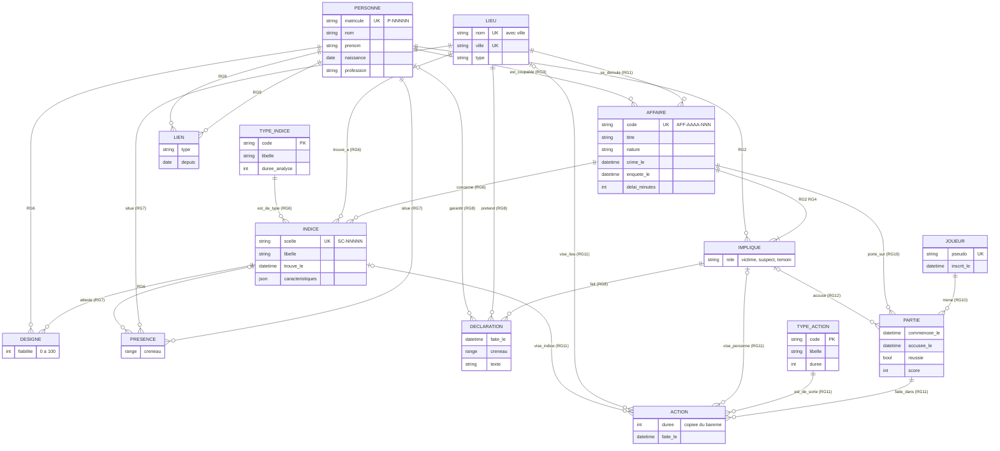

# Conception · Le mur de l'enquêteur

Un jeu d'enquête policière. La base garde des affaires fictives : les personnes impliquées, ce qu'elles déclarent,
les indices placés sous scellé, les présences que ces indices attestent, et les liens entre les personnes (le « mur »
aux fils rouges). Un joueur ouvre une affaire avec un délai, par exemple 30 heures d'enquête. Chaque action lui coûte
du temps sur ce délai : interroger une personne, faire une enquête de voisinage, fouiller un lieu, faire analyser un
scellé. Il ne peut pas tout faire : il choisit, puis il accuse un suspect. Chaque affaire a un coupable caché, dont
l'alibi ment.

Sommaire : [1. Le cahier des charges](#1-le-cahier-des-charges) · [2. Le MCD](#2-le-mcd) ·
[3. Le MLD dans PostgreSQL](#3-le-mld-dans-postgresql) · [4. Ce que le schéma ne garantit pas](#4-ce-que-le-schéma-ne-garantit-pas)

La base choisie et sa justification : [docs/adr/0001-postgresql-seul.md](docs/adr/0001-postgresql-seul.md).

---

## 1. Le cahier des charges

### Les règles de gestion

- **RG1.** Une affaire a un code unique (`AFF-AAAA-NNN`), un titre, une nature (meurtre, vol, empoisonnement,
  incendie, enlèvement), une date et une heure. Elle se déroule dans **un seul** lieu ; un lieu peut n'avoir connu
  aucune affaire, ou plusieurs. Elle a **toujours** une heure de début d'enquête, après les faits, et un délai
  d'enquête (entre 1 heure et 7 jours).
- **RG2.** Une personne a un matricule unique (`P-NNNNN`). Elle peut être impliquée dans **aucune** ou plusieurs
  affaires. Dans une affaire, elle a **un seul** rôle : victime, suspect ou témoin. Une affaire a **toujours une et
  une seule** victime.
- **RG3.** Une affaire a **exactement un** coupable, qui est **toujours** un de ses suspects. Le joueur ne le voit
  pas avant d'avoir accusé.
- **RG4.** Une affaire a **au moins trois** suspects.
- **RG5.** Un lieu a un nom unique dans sa ville.
- **RG6.** Un indice a un numéro de scellé unique (`SC-NNNNN`). Il est trouvé dans **un seul** lieu, pour **une
  seule** affaire, et il est d'**un seul** type, pris dans une liste fixe (empreinte, ADN, vidéo, bornage, document,
  objet). Le type fixe la durée de son analyse au labo, et ses caractéristiques : une vidéo ou un bornage a
  **toujours** un début et une fin ; une empreinte a **toujours** un doigt ; les autres champs sont **facultatifs**.
  Un indice désigne **aucune** ou plusieurs personnes, chacune avec une fiabilité de 0 à 100 %.
- **RG7.** Une présence attestée situe **une** personne dans **un** lieu, sur un créneau. Elle est attestée par
  **au plus un** indice (une caméra, un bornage). Une personne n'est **jamais** à deux endroits à la fois : ses
  présences attestées ne se chevauchent pas.
- **RG8.** Une déclaration est faite par une personne **impliquée dans l'affaire**. Elle dit dans quel lieu la
  personne prétend avoir été, sur quel créneau, et avec **au plus un** garant, qui n'est pas elle-même. Une
  déclaration **peut mentir** : rien n'interdit qu'elle contredise une présence attestée.
- **RG9.** Un lien relie **deux personnes distinctes**, avec un type (famille, couple, ex, ami, collègue, dette,
  rivalité) et une date de début. Entre deux personnes, il y a **au plus un** lien d'un type donné. Un lien n'a pas
  de sens : « A est l'ami de B », c'est « B est l'ami de A ».
- **RG10.** Un joueur a un pseudo unique. Il peut mener **aucune** ou plusieurs parties. Une partie porte sur **une
  seule** affaire, et un joueur a **au plus une partie en cours** sur une même affaire.
- **RG11.** Pendant une partie en cours, le joueur fait des actions. Chaque action est d'**une seule** sorte, et vise
  **une seule** cible : interroger une personne de l'affaire (2 h), faire une enquête de voisinage sur une personne de
  l'affaire (1 h), fouiller un lieu (3 h), ou faire analyser un indice de l'affaire (la durée de son type). La durée
  est fixée par le barème au moment de l'action, et ne change plus. La même action sur la même cible se fait **au plus
  une fois** par partie. La somme des durées ne dépasse **jamais** le délai de l'affaire.
- **RG12.** Une partie se termine par **une seule** accusation, contre un **suspect de cette affaire**. Elle est
  définitive : la partie ne se modifie plus et ne reçoit plus d'action. Le score est calculé à ce moment-là :
  50 points, plus 10 par heure restante sur le délai, si l'accusation est juste ; 0 sinon.

### Les questions qu'on s'est posées

| Question | Réponse retenue | Règle |
|---|---|---|
| Une personne peut-elle exister sans être impliquée dans une affaire ? | Oui : un garant ou un proche sur le mur n'a pas forcément de rôle. | RG2 (0,n) |
| Une personne peut-elle être suspecte dans une affaire et témoin dans une autre ? | Oui, le rôle dépend de l'affaire : il est porté par l'implication, pas par la personne. | RG2 |
| Peut-il y avoir deux coupables (des complices) ? | Non, un seul coupable par affaire. Le complice existe sur le mur (le faux garant), mais il n'est pas accusable. | RG3 |
| Pourquoi au moins trois suspects ? | Avec un ou deux, le jeu est trop facile. | RG4 |
| Un indice peut-il ne désigner personne ? | Oui : un gant sans propriétaire, un ticket de vestiaire. Les fausses pistes font le jeu. | RG6 (0,n) |
| Une déclaration fausse doit-elle être refusée ? | Non. C'est tout le jeu : la base enregistre le mensonge, et une requête le trouve. | RG8 |
| Une présence attestée et une déclaration, est-ce la même chose ? | Non. La présence est un fait prouvé par un indice ; la déclaration est ce que dit la personne. Les mélanger rendrait le mensonge impossible à ranger. | RG7, RG8 |
| Un lien a-t-il un sens ? | Non (ami, famille, dette…) : on le range une seule fois. | RG9 |
| Peut-on rejouer une affaire ? | Oui, avec une nouvelle partie, mais pas deux en même temps. | RG10 |
| Le temps est-il un vrai chronomètre ? | Non. C'est une monnaie : seules les actions font avancer l'horloge du jeu. Le joueur peut réfléchir aussi longtemps qu'il veut. | RG11 |
| Si le barème change (une analyse ADN passe à 8 h), les parties passées changent-elles ? | Non : chaque action garde la durée qu'elle a coûtée ce jour-là, comme le prix payé d'une commande. | RG11 |
| Analyser deux fois le même scellé coûte-t-il deux fois ? | Non, la même action sur la même cible se fait une seule fois. | RG11 |
| Que se passe-t-il quand le délai est épuisé ? | Plus aucune action n'est possible, il ne reste qu'à accuser. | RG11, RG12 |
| Peut-on changer d'avis après avoir accusé ? | Non, l'accusation est définitive. | RG12 |

---

## 2. Le MCD

### Les entités et leurs identifiants

| Entité | Identifiant | Identifiant métier | Propriétés |
|---|---|---|---|
| AFFAIRE | id | **code** (`AFF-2026-001`) | titre, nature, résumé, date et heure du crime, début de l'enquête, délai |
| PERSONNE | id | **matricule** (`P-00042`) | nom, prénom, date de naissance, profession |
| LIEU | id | **(nom, ville)** | type |
| INDICE | id | **scellé** (`SC-00138`) | libellé, trouvé le, caractéristiques (variables selon le type) |
| TYPE D'INDICE | **code** (`bornage`) | le code | libellé, durée d'analyse |
| PRÉSENCE | id | aucun | créneau |
| DÉCLARATION | id | aucun | faite le, créneau, texte |
| JOUEUR | id | **pseudo** | inscrit le |
| PARTIE | id | aucun | commencée le, réussie, score |
| SORTE D'ACTION | **code** (`fouiller`) | le code | libellé, durée |
| ACTION | id | aucun | durée, faite le |

Une présence et une déclaration sont des entités, pas des associations : une même personne peut être vue
plusieurs fois au même endroit, et déclarer plusieurs fois la même chose. Elles ont donc besoin de leur propre identifiant.
Une action aussi : elle vise *soit* une personne, *soit* un lieu, *soit* un indice. Ce n'est pas une association
entre une partie et une cible fixe, c'est une entité reliée à trois cibles possibles, dont une seule est remplie.

### Le diagramme



Mermaid ne dessine que les entités : les associations qui portent des données (IMPLIQUE, DÉSIGNE, LIEN)
y apparaissent comme des boîtes. Les cardinalités Merise, avec leur règle, sont dans le tableau ci-dessous.

### Les associations et leurs cardinalités

| Association | Entre | Cardinalités | Données portées | Règle |
|---|---|---|---|---|
| SE DÉROULE | AFFAIRE, LIEU | affaire **1,1** · lieu **0,n** | | RG1 : un seul lieu ; un lieu sans affaire possible |
| **IMPLIQUE** | AFFAIRE, PERSONNE | affaire **4,n** · personne **0,n** | **rôle** | RG2 : un seul rôle par affaire, une personne sans affaire possible ; RG2 + RG4 : une victime et trois suspects, donc au moins 4 |
| EST COUPABLE | AFFAIRE, PERSONNE | affaire **1,1** · personne **0,n** | | RG3 : exactement un coupable, pris parmi les suspects |
| CONCERNE | INDICE, AFFAIRE | indice **1,1** · affaire **0,n** | | RG6 : une seule affaire |
| TROUVÉ À | INDICE, LIEU | indice **1,1** · lieu **0,n** | | RG6 : un seul lieu |
| **DÉSIGNE** | INDICE, PERSONNE | indice **0,n** · personne **0,n** | **fiabilité** | RG6 : un indice peut ne désigner personne |
| SITUE (personne) | PRÉSENCE, PERSONNE | présence **1,1** · personne **0,n** | | RG7 : une personne |
| SITUE (lieu) | PRÉSENCE, LIEU | présence **1,1** · lieu **0,n** | | RG7 : un lieu |
| ATTESTE | PRÉSENCE, INDICE | présence **0,1** · indice **0,n** | | RG7 : au plus un indice ; une vidéo peut montrer plusieurs personnes |
| FAIT | DÉCLARATION, IMPLIQUE | déclaration **1,1** · implication **0,n** | | RG8 : faite par une personne *impliquée dans l'affaire* (on rattache la déclaration à l'implication, pas à la personne seule) |
| PRÉTEND | DÉCLARATION, LIEU | déclaration **1,1** · lieu **0,n** | | RG8 : un lieu prétendu |
| GARANTIT | DÉCLARATION, PERSONNE | déclaration **0,1** · personne **0,n** | | RG8 : au plus un garant |
| **LIEN** (réflexive) | PERSONNE, PERSONNE | **0,n** · **0,n** | **type, depuis** | RG9 : au plus un lien d'un type donné entre deux personnes |
| EST DE TYPE | INDICE, TYPE D'INDICE | indice **1,1** · type **0,n** | | RG6 : un seul type ; un type peut n'avoir aucun indice |
| MÈNE | PARTIE, JOUEUR | partie **1,1** · joueur **0,n** | | RG10 |
| PORTE SUR | PARTIE, AFFAIRE | partie **1,1** · affaire **0,n** | | RG10 : une seule affaire |
| ACCUSE | PARTIE, IMPLIQUE | partie **0,1** · implication **0,n** | (date dans PARTIE) | RG12 : une seule accusation, 0 tant que la partie est en cours ; on accuse une *implication de suspect*, pas une personne quelconque |
| FAITE DANS | ACTION, PARTIE | action **1,1** · partie **0,n** | | RG11 : une partie commence sans action |
| EST DE SORTE | ACTION, SORTE D'ACTION | action **1,1** · sorte **0,n** | | RG11 : une seule sorte |
| VISE (personne) | ACTION, IMPLIQUE | action **0,1** · implication **0,n** | | RG11 : on interroge une personne *de l'affaire* |
| VISE (lieu) | ACTION, LIEU | action **0,1** · lieu **0,n** | | RG11 |
| VISE (indice) | ACTION, INDICE | action **0,1** · indice **0,n** | | RG11 : un indice *de l'affaire* |

Les trois VISE sont exclusives : une action a exactement une cible, et la sorte dit laquelle (contrainte d'exclusivité
entre associations, notée ⊕ en Merise).

Les associations qui portent des données sont bien placées : le **rôle** dépend du couple (affaire, personne) et
de rien d'autre (une même personne est suspecte ici, témoin là) ; la **fiabilité** dépend du couple (indice,
personne) ; le **type** d'un lien dépend des deux personnes. La **durée** d'une action est portée par l'action,
pas par sa sorte : c'est ce que l'action a coûté, comme le prix payé d'une ligne de commande (RG6 d'Ombelle).

---

## 3. Le MLD dans PostgreSQL

La base retenue est PostgreSQL (voir l'[ADR 0001](docs/adr/0001-postgresql-seul.md)). On applique les règles de
passage de la séance 1 : une association avec un **1,1** devient une clé étrangère du côté 1,1 ; les autres
deviennent une table, dont la clé est la combinaison des clés.

```
lieux (id, nom, ville, type)
    PK id · UNIQUE (nom, ville)                                                       RG5

personnes (id, matricule, nom, prenom, naissance, profession)
    PK id · UNIQUE matricule                                                          RG2

affaires (id, code, titre, nature, resume, crime_le, #lieu_crime_id, enquete_le, delai_minutes, coupable_id, coupable_role)
    PK id · UNIQUE code · CHECK enquete_le > crime_le · CHECK delai_minutes 60..10080   RG1
    FK lieu_crime_id → lieux                                                          RG1 (SE DÉROULE, 1,1)
    FK (id, coupable_id, coupable_role) → implications (affaire_id, personne_id, role) RG3 (EST COUPABLE, 1,1)
       coupable_role = 'suspect', colonne générée ; FK différée

implications (#affaire_id, #personne_id, role)
    PK (affaire_id, personne_id)                                                      RG2 (IMPLIQUE, n,n)
    UNIQUE (affaire_id, personne_id, role)            cible des FK « coupable » et « accusé »
    UNIQUE (affaire_id) WHERE role = 'victime'        une seule victime                RG2

types_indice (code, libelle, duree_analyse)
    PK code · UNIQUE libelle                          table de référence, 6 lignes     RG6

indices (id, scelle, #affaire_id, #lieu_id, #type, libelle, trouve_le, caracteristiques jsonb)
    PK id · UNIQUE scelle · UNIQUE (id, affaire_id)
    FK type → types_indice                                                            RG6 (EST DE TYPE, 1,1)
    FK affaire_id → affaires                                                          RG6 (CONCERNE, 1,1)
    FK lieu_id → lieux                                                                RG6 (TROUVÉ À, 1,1)
    CHECK video/bornage ⇒ debut et fin ; empreinte ⇒ doigt                            RG6
    INDEX GIN (caracteristiques)

designations (#indice_id, #personne_id, fiabilite)
    PK (indice_id, personne_id) · CHECK fiabilite 0..100                              RG6 (DÉSIGNE, n,n)

presences (id, #personne_id, #lieu_id, creneau tstzrange, #indice_id NULL)
    PK id
    FK personne_id → personnes, lieu_id → lieux                                       RG7 (SITUE, 1,1)
    FK indice_id → indices, facultative                                               RG7 (ATTESTE, 0,1)
    EXCLUDE (personne_id =, creneau &&)               jamais deux endroits à la fois  RG7

declarations (id, #affaire_id, #personne_id, faite_le, #lieu_id, creneau, #garant_id NULL, texte)
    PK id
    FK (affaire_id, personne_id) → implications                                       RG8 (FAIT, 1,1)
    FK lieu_id → lieux                                                                RG8 (PRÉTEND, 1,1)
    FK garant_id → personnes, facultative · CHECK garant ≠ personne                   RG8 (GARANTIT, 0,1)

liens (#personne_a, #personne_b, type, depuis)
    PK (personne_a, personne_b, type) · CHECK personne_a < personne_b                 RG9 (LIEN, n,n)

joueurs (id, pseudo, inscrit_le)
    PK id · UNIQUE pseudo                                                             RG10

parties (id, #joueur_id, #affaire_id, commencee_le, accuse_id NULL, accuse_role, accusee_le, reussie, score)
    PK id · UNIQUE (id, affaire_id)
    FK joueur_id → joueurs                                                            RG10 (MÈNE, 1,1)
    FK affaire_id → affaires                                                          RG10 (PORTE SUR, 1,1)
    FK (affaire_id, accuse_id, accuse_role) → implications, facultative               RG12 (ACCUSE, 0,1)
    UNIQUE (joueur_id, affaire_id) WHERE accuse_id IS NULL   une partie en cours       RG10
    CHECK accuse_id, accusee_le, reussie, score tous nuls ou tous remplis              RG12

types_action (code, libelle, duree NULL)
    PK code · UNIQUE libelle      4 lignes ; duree NULL pour « analyser » (voir types_indice)   RG11

actions (id, #partie_id, affaire_id, #type, #personne_id NULL, #lieu_id NULL, #indice_id NULL, duree, faite_le)
    PK id
    FK (partie_id, affaire_id) → parties (id, affaire_id)                             RG11 (FAITE DANS, 1,1)
    FK type → types_action                                                            RG11 (EST DE SORTE, 1,1)
    FK (affaire_id, personne_id) → implications, facultative   une personne de l'affaire   RG11 (VISE, 0,1)
    FK lieu_id → lieux, facultative                                                   RG11 (VISE, 0,1)
    FK (indice_id, affaire_id) → indices (id, affaire_id), facultative   un indice de l'affaire   RG11 (VISE, 0,1)
    CHECK selon type : exactement la bonne cible remplie                  l'exclusivité ⊕   RG11
    UNIQUE NULLS NOT DISTINCT (partie_id, type, personne_id, lieu_id, indice_id)  une fois    RG11

vue temps_parties (partie_id, delai_minutes, utilise, restant, horloge)    calculée, pas recopiée
vue affaires_publiques : affaires sans coupable_id                                    RG3
```

Le MPD complet, rejouable, est dans [modele/schema.sql](modele/schema.sql), et les 29 tests de
[modele/verifier.sql](modele/verifier.sql) montrent que chaque règle est tenue.

### Chaque association, et pourquoi elle est rangée ainsi

| Association | Devient | Pourquoi |
|---|---|---|
| SE DÉROULE, CONCERNE, TROUVÉ À, EST DE TYPE, SITUE, PRÉTEND, MÈNE, PORTE SUR, FAITE DANS, EST DE SORTE | une clé étrangère `NOT NULL` | un côté est en 1,1 : la clé part de ce côté (règle de passage) |
| ATTESTE, GARANTIT | une clé étrangère **nullable** | un côté est en 0,1 : la clé peut manquer |
| EST COUPABLE | une FK composite `(id, coupable_id, 'suspect')` vers `implications` | 1,1 côté affaire ; viser `implications` avec le rôle garantit au passage que le coupable est un *suspect de cette affaire* (RG3), sans trigger |
| ACCUSE | une FK composite nullable vers `implications`, avec le rôle | 0,1 côté partie ; même idée : on ne peut accuser qu'un suspect de l'affaire de la partie (RG12) |
| les trois VISE | trois clés étrangères **nullables** dans `actions`, et un `CHECK` d'exclusivité | 0,1 côté action ; le `CHECK` dit laquelle est remplie selon la sorte. Les FK composites avec `affaire_id` garantissent que la personne et l'indice sont *de l'affaire de la partie* (RG11), sans trigger |
| FAIT | une FK composite `(affaire_id, personne_id)` vers `implications` | la déclaration dépend de l'implication, pas de la personne seule : une personne hors de l'affaire ne peut rien y déclarer (RG8) |
| IMPLIQUE, DÉSIGNE | une table, dont la clé est le couple des clés | n,n : il faut une table ; elle porte les données de l'association (rôle, fiabilité) |
| LIEN | une table, avec `personne_a < personne_b` | n,n réflexive et sans sens : on range chaque lien une seule fois, sinon « A ami de B » et « B ami de A » pourraient se contredire |

### Ce qu'on recopie exprès

La base est en troisième forme normale, sauf cinq copies voulues. Pour chacune, on dit qui la tient à jour.

| Copie | Pourquoi | Qui la tient à jour |
|---|---|---|
| `actions.affaire_id` (déjà connue par la partie) | pour que les FK composites garantissent que la personne, l'indice et la partie sont de la même affaire (RG11), sans trigger | personne : les FK refusent une valeur fausse, la copie ne peut pas mentir |
| `actions.duree` (déjà dans le barème) | c'est ce que l'action a **coûté** : si le barème change, les parties passées gardent leur temps (comme le prix payé d'Ombelle) | le trigger `avant_action` la remplit d'après le barème ; ce que l'application écrit est écrasé ; un trigger interdit ensuite de la modifier |
| `affaires.coupable_role` et `parties.accuse_role`, toujours `'suspect'` | pour pouvoir viser `implications (affaire_id, personne_id, role)` avec une FK | PostgreSQL : ce sont des colonnes générées, non modifiables |
| `parties.score` et `parties.reussie` (calculables à partir des actions et du coupable) | le tableau d'honneur les lit à chaque page d'accueil | la fonction `accuser()`, une seule fois, dans la transaction de l'accusation ; puis un trigger interdit toute modification (RG12). Comme le total d'une commande payée en séance 2 (D2) : la copie ne peut plus devenir fausse |
| **pas** de copie du temps utilisé dans `parties` | il change à chaque action ; une copie serait une ligne chaude à tenir à jour, pour une somme de quelques lignes | rien : la vue `temps_parties` le calcule à la demande |
| aucune copie du nom des personnes ou des lieux | une jointure suffit, les pages s'affichent en quelques millisecondes : rien à gagner (comme D1 en séance 2) | |

---

## 4. Ce que le schéma ne garantit pas

Les contraintes (PK, FK, UNIQUE, CHECK, EXCLUDE) tiennent la plupart des règles. Voici ce qu'elles ne savent pas
dire, et l'endroit où on le garantit.

| Règle | Ce que le schéma seul laisse passer | Où on le garantit |
|---|---|---|
| RG2 | une affaire **sans** victime (l'index unique empêche deux victimes, pas zéro) | **trigger** de contrainte différé `trois_suspects`, vérifié en fin de transaction |
| RG4 | une affaire avec moins de trois suspects : une contrainte ne compte pas les lignes d'une autre table | le **même trigger** différé : l'affaire et ses implications s'écrivent dans une seule transaction, le compte se fait au `COMMIT` |
| RG3 | que le joueur **voie** le coupable : c'est une colonne comme une autre | **la vue** `affaires_publiques` (sans `coupable_id`) est la seule que lit l'application avant l'accusation ; la comparaison se fait dans la fonction `accuser()` (`SECURITY DEFINER`). Pour aller plus loin, un rôle `joueur` sans droit sur la colonne |
| RG11 | que la somme des durées dépasse le délai : une contrainte ne fait pas de somme sur plusieurs lignes | **trigger** `avant_action` (`BEFORE INSERT`) : il verrouille la partie (`FOR UPDATE`), additionne les durées et refuse l'action de trop. Le verrou empêche deux actions simultanées de dépasser le délai à elles deux |
| RG11 | qu'une action ait la durée du barème : la colonne accepterait n'importe quel nombre | le **même trigger** : il lit `types_action` ou `types_indice` et écrase la durée écrite ; `action_figee` interdit ensuite de la changer |
| RG12 | qu'on modifie une partie après l'accusation, ou qu'on y fasse encore une action | **triggers** `partie_figee` (`BEFORE UPDATE`) et `avant_action` |
| RG12 | un score faux, ou calculé en deux fois | la **transaction** de `accuser()` : elle verrouille la partie, lit le temps restant, compare au coupable et écrit le score en une seule fois |
| jeu | que le joueur ne voie que ce qu'il a découvert (une déclaration seulement après l'interrogatoire, un scellé seulement après la fouille) | **le code** de l'application : chaque page filtre sur les actions de la partie |
| jeu | qu'on ne fouille qu'un lieu dont le joueur a entendu parler, et qu'on n'interroge pas la victime | **le code** : la base accepte n'importe quel lieu et n'importe quelle personne de l'affaire, l'application ne propose que les lieux connus |
| RG6 | la forme complète des caractéristiques (un `montant` négatif, un champ inconnu) : le `CHECK` ne vérifie que le minimum de chaque type | **le code** : le générateur écrit des caractéristiques complètes ; une application qui en saisirait devrait les valider |
| RG8 | une déclaration qui contredit une présence attestée | **personne, exprès** : c'est le jeu. La requête Q2 de [modele/requetes.sql](modele/requetes.sql) trouve les contradictions |
| jouabilité | qu'une affaire soit résoluble dans le délai, mais pas en analysant tout | **le générateur** : le lieu des faits contient 26 h d'analyses (plus la fouille, 29 h) pour un délai de 26 à 30 h, et le coupable est confondu en 13 h si l'on choisit bien (fouille, relevé d'antenne, interrogatoire). Le barème suit la valeur des indices : le relevé d'antenne, qui prouve tout, est le plus cher (8 h), l'objet le moins cher (1 h). Testé sur les 6 affaires générées. La requête Q2 retrouve l'alibi qui ment |
| RG9 | qu'un lien ait un sens réel (A doit de l'argent à B, ou B à A ?) | **hors périmètre** : le lien « dette » n'a pas de sens dans ce modèle, c'est un choix (RG9) |
| fuseau horaire | que l'affichage soit à l'heure de Paris | **le code** : le générateur et l'application fixent `TimeZone = Europe/Paris` |
